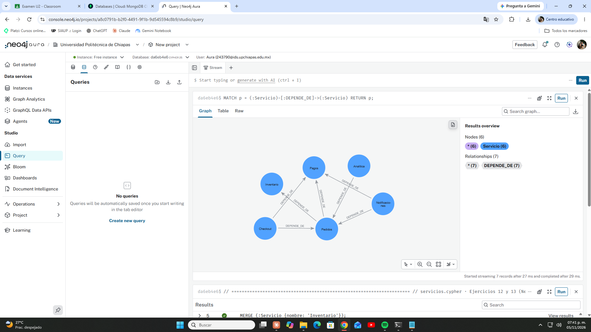
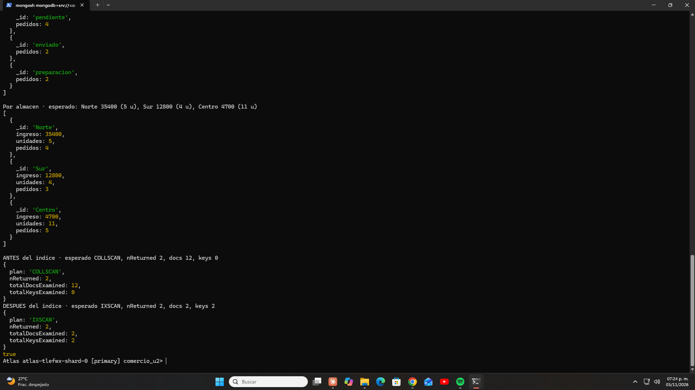

# Mercado Ágil · Prototipo NoSQL con MongoDB Atlas y Neo4j AuraDB

Prototipo de gestión de pedidos para una tienda ficticia, construido en la nube con planes gratuitos. Cubre el ciclo completo de una base de datos NoSQL: **modelado, integridad, consultas, agregaciones, optimización con índices, control de acceso por roles, monitoreo, respaldo y restauración verificada**, además de un **grafo de dependencias** para análisis de impacto.

Proyecto del examen práctico de la Unidad II de *Bases de Datos en la Nube* (Ingeniería en TI e Innovación Digital, Universidad Politécnica de Chiapas).

## Tecnologías

| Herramienta | Uso |
|---|---|
| MongoDB Atlas M0 (replica set de 3 nodos) | Base de datos documental `comercio_u2` |
| mongosh | Ejecución de scripts y consultas |
| MongoDB Database Tools | `mongodump` y `mongorestore` |
| Neo4j AuraDB Free + Cypher | Grafo de servicios y consultas de impacto |
| PowerShell (Windows) | Terminal de trabajo |

## Qué demuestra

- **Modelado de documentos:** `productos` como colección independiente y los artículos de cada pedido **incrustados** en el documento, porque un pedido siempre se consulta completo. Fechas como `Date` reales y totales verificados.
- **Integridad:** validador `$jsonSchema` con `validationLevel: strict` y `validationAction: error`; índice único en `sku`. Pruebas negativas rechazadas con los códigos **121** (validación) y **11000** (llave duplicada).
- **Consultas:** filtros compuestos, proyección, ordenamiento, rangos de fechas con `$gte`/`$lt` y búsqueda dentro de arreglos con notación de punto.
- **Cambios seguros:** `updateOne` condicionados (`matchedCount`/`modifiedCount`), `$inc` con control de existencias, `$addToSet`, `$pull` y borrado inequívoco.
- **Agregaciones:** `$group`, `$unwind`, `$addToSet` + `$size` y `$sort` para reportes por estado y por almacén.
- **Optimización:** `explain("executionStats")` antes y después de un índice compuesto `{estado: 1, prioridad: 1}`: de **COLLSCAN con 12 documentos examinados** a **IXSCAN con 2**.
- **Seguridad (mínimo privilegio):** tres usuarios con privilegios específicos; el analista solo lee y el operador no puede escribir fuera de su base.
- **Monitoreo:** lectura de las métricas *Connections* y *Opcounters* del replica set (nodo primario y secundarios).
- **Recuperación:** respaldo comprimido con `mongodump` y restauración en una base distinta con `--nsFrom`/`--nsTo`, comprobada documento por documento.
- **Grafos:** 6 nodos `:Servicio`, 7 relaciones `DEPENDE_DE`, restricción de unicidad y consultas de impacto directo y transitivo (`*1..3`).

## Estructura

```
scripts/
  01_productos_pedidos.js        Productos, validador y carga de 12 pedidos
  02_pruebas_integridad.js       Pruebas negativas e índice único
  03_consultas.js                Seis consultas con resultado esperado
  04_cambios_controlados.js      Actualizaciones condicionadas y borrado seguro
  05_agregaciones_indice.js      Reportes y explain antes/después del índice
  06a_prueba_analista.js         Prueba de permisos de solo lectura
  06b_prueba_operador.js         Prueba de permisos de lectura/escritura
  07_verificar_restauracion.js   Comparación entre base original y restaurada
  servicios.cypher               Grafo de servicios en Neo4j
  respaldo_comandos.txt          Comandos de mongodump y mongorestore
docs/
  Guia_paso_a_paso.pdf           Guía completa con explicación de cada paso
  capturas/                      Evidencias de ejecución
```

## Cómo ejecutarlo

1. Crear un clúster **M0 Free** en MongoDB Atlas y autorizar la IP del equipo en *IP Access List*.
2. Crear los usuarios con *Specific Privileges*:

| Usuario | Privilegios |
|---|---|
| `admin_tienda` | `readWrite` y `dbAdmin` en `comercio_u2` y `comercio_u2_restaurada` |
| `analista_tienda` | `read` en `comercio_u2` |
| `operador_tienda` | `readWrite` en `comercio_u2` |

3. Instalar las herramientas:

```powershell
winget install MongoDB.Shell
winget install MongoDB.DatabaseTools
```

4. Desde la raíz del repositorio, conectarse como `admin_tienda` (la contraseña la pide la terminal):

```powershell
mongosh "mongodb+srv://<host>/comercio_u2" --apiVersion 1 --username admin_tienda
```

5. Ejecutar los scripts en orden:

```js
load("scripts/01_productos_pedidos.js")
load("scripts/02_pruebas_integridad.js")
load("scripts/03_consultas.js")
load("scripts/04_cambios_controlados.js")
load("scripts/05_agregaciones_indice.js")
```

6. Probar permisos conectándose como `analista_tienda` (script `06a`) y `operador_tienda` (script `06b`).
7. Respaldo y restauración: ver `scripts/respaldo_comandos.txt`; después, como `admin_tienda`, `load("scripts/07_verificar_restauracion.js")`.
8. En Neo4j AuraDB Free, pegar `scripts/servicios.cypher` en el editor *Query* y ejecutarlo.

## Resultados

| Prueba | Resultado |
|---|---|
| Carga inicial | 5 productos, 12 pedidos, 0 importes incorrectos |
| Cantidad 0 / estado no permitido | Rechazados, código 121 |
| SKU duplicado | Rechazado, código 11000 |
| Índice compuesto | COLLSCAN 12 docs → IXSCAN 2 docs |
| Analista intenta actualizar | Rechazado (Atlas M0 responde con código 8000, equivalente a 13 *Unauthorized*) |
| Operador escribe en otra base | Rechazado |
| Respaldo y restauración | 17 documentos restaurados, 0 fallidos; índices y validador idénticos |
| Impacto si falla Pagos | Directo: Checkout, Notificaciones, Pedidos · En cadena: + Analítica |





## Buenas prácticas aplicadas

- Ninguna contraseña ni cadena de conexión con credenciales en el código, las capturas o el historial del repositorio.
- Solo planes gratuitos.
- Restauración en una base distinta, sin `--drop`, para no tocar los datos originales.
- Scripts con verificación integrada: cada uno imprime el resultado esperado junto al obtenido.
- Todos los datos son ficticios.

## Autor

**Carlos Andrés Mazariegos Laguna** · Estudiante de Ingeniería en Tecnologías de la Información e Innovación Digital, Universidad Politécnica de Chiapas.
